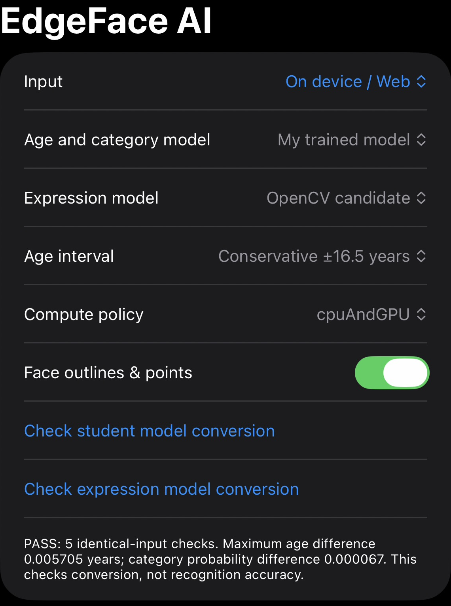
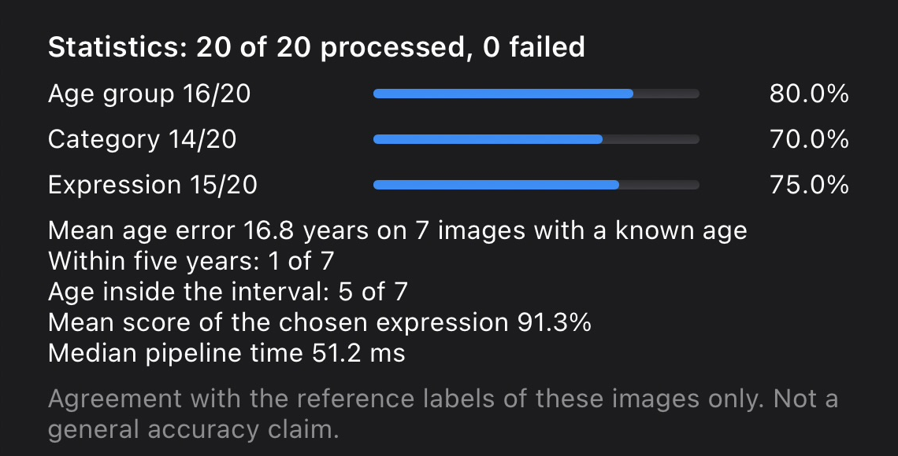
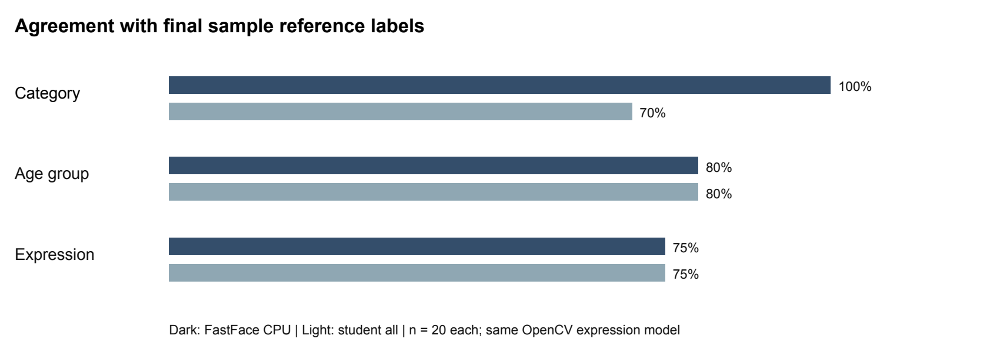
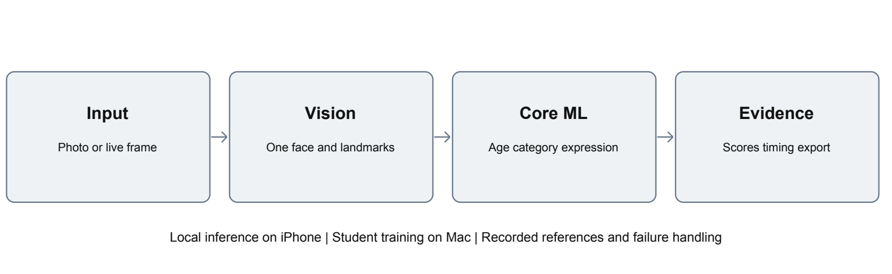

<div align="center">

# 👁️ EdgeFace AI

### On-device facial attributes from photos and live video

An iPhone research prototype built with SwiftUI, Vision and Core ML, with a student-trained age/category model and a pretrained expression model.

[](https://www.swift.org/)
[](https://developer.apple.com/xcode/swiftui/)
[](https://developer.apple.com/machine-learning/core-ml/)
[](https://pytorch.org/)


**IU Project Report · Project Edge AI · Task 2**

</div>

## In-app screenshots

<table>
<tr><th>1. Controls and conversion check</th><th>2. Recorded evaluation results</th></tr>
<tr>
<td valign="top"></td>
<td valign="top"><p>The app displays age-group, category and expression agreement, numerical-age error, interval coverage and pipeline time. These are recorded results on the project sample.</p><p>For a first test, follow the walkthrough below using <b>Photos</b> mode. The research galleries shown in the original screenshots are optional.</p></td>
</tr>
</table>

*Real iPhone screenshots supplied by the student, cropped to show the interface and
aggregate results without participant photographs. Displayed values are unchanged.
The controls screenshot shows the original five-input student conversion check;
the public demo includes three synthetic inputs and reports that count instead.*

## Start here — instructor walkthrough

**What you need:** a **Mac with Xcode**. The app and all three models are included;
**no training or dataset download is required**. Use the Simulator for photo testing,
or an iPhone for the live camera.

### 1. Download and open

On this page choose **Code → Download ZIP**, unzip it, then double-click
**EdgeFaceAI.xcodeproj**. Alternatively, use Terminal:

```sh
git clone https://github.com/ApteryxDev/EdgeFaceAI.git
cd EdgeFaceAI
open EdgeFaceAI.xcodeproj
```

### 2. Choose where to run

At the top of Xcode, select the **EdgeFaceAI** scheme and an installed **iPhone
Simulator** (for example, iPhone 18 Pro). Press the **▶ Run** button or **⌘R**.
Wait for the build and device startup to finish. Simulator builds do not require
an Apple signing team. Development/build verification uses Xcode 27.2; iOS 17 is
the deployment target.

**Using a real iPhone instead?** Connect and trust it, enable Developer Mode, select
it as the run destination, and choose **your own team** in the target's
**Signing & Capabilities** tab. Use a unique bundle identifier if Xcode requests one.
Then press Run. These signing steps are unnecessary for the Simulator.

### 3. Try a photograph

1. In Simulator, open **Photos** and add a single-face image you have permission to
   use by dragging the image file onto the Simulator. On an iPhone, use an existing photo.
2. Open **EdgeFace AI**, keep **Input → Photos**, and tap **Select photo**.
3. Select the image, then tap **Analyze photo on device**.
4. Scroll below the image to inspect the age estimate, dataset category, expression,
   model scores and pipeline time. The app requires exactly **one face**.

### 4. Compare the models and check conversion

- In **Age and category model**, switch between **My trained model** and
  **FastFace baseline**, then analyze the same image again.
- Keep **Expression model → OpenCV candidate**. The expression model is shared.
- Tap **Check student model conversion** and **Check expression model conversion**
  separately. Each runs three bundled synthetic inputs and reports PASS/FAIL.
  These are numerical conversion checks, not recognition-accuracy measurements.
- Use **Export saved results** to save the predictions as JSON before closing.

### 5. Try live video (physical iPhone)

Change **Input → Camera**, tap **Start camera**, and allow camera access when
prompted. Keep one face in view. Stop the camera before changing models or lenses.
Live camera testing needs a physical iPhone; use Photos mode in Simulator.

**Need help?** [Detailed setup and troubleshooting](docs/SETUP.md) ·
[Build verification](docs/BUILD_VERIFICATION.md) ·
[Model provenance](Models/THIRD_PARTY_NOTICES.md)

---

## 📖 Overview

I built EdgeFace AI to explore what happens when facial-attribute models move from a training environment to an actual phone. The application estimates age, a dataset-defined gender category and a visible facial-expression category from a selected photograph or a live camera feed. All inference stays on the device.

The project compares two age/category models and uses a separate model for expressions:

| | Model | Role |
|:---:|---|---|
| 🧪 | **Student MobileNetV3 Small** | ImageNet-pretrained backbone with age and category heads trained in this project on UTKFace |
| 🔍 | **FastFace Large 128** | Externally trained age/category baseline, retained for comparison |
| 🙂 | **OpenCV Progressive Teacher MobileFaceNet** | Externally pretrained facial-expression model, converted for Core ML |

The main questions were whether the app could work locally, whether conversion preserved numerical outputs, and how recognition and latency changed once the models were deployed.

> 🎓 **Course:** Project Edge AI — DLBAIPEAI01, Task 2  
> 🏫 **IU International University of Applied Sciences**

---

## 🏆 Key Results

The final frozen sample contains **20 images**, evaluated with five configurations on an iPhone Air. The CPU-and-GPU runs were recorded on **13 November 2026**; the CPU-only and All runs were recorded on 12 November. All five use the same OpenCV expression model.

| Measure | 🔍 FastFace CPU | 🔍 FastFace CPU + GPU | 🔍 FastFace All | 🧪 Student CPU + GPU | 🧪 Student All |
|---|:---:|:---:|:---:|:---:|:---:|
| Successfully processed | **20/20** | **20/20** | **20/20** | **20/20** | **20/20** |
| Dataset-category agreement | **20/20** | **20/20** | **20/20** | 14/20 | 14/20 |
| Age-group agreement | 16/20 | 16/20 | 16/20 | 16/20 | 16/20 |
| Expression agreement | 15/20 | 15/20 | 15/20 | 15/20 | 15/20 |
| Age MAE on 7 known ages | **14.95 years** | **14.95 years** | **14.95 years** | 16.76 years | 16.76 years |
| Median pipeline time | **46.11 ms** | 52.18 ms | 55.58 ms | 51.21 ms | 52.52 ms |

The added CPU-and-GPU runs preserve the earlier winning labels for each model. Student age outputs match its All run exactly; FastFace age differences stay below 0.0001 years across its final-sample configurations. The policy names describe allowed Core ML units, not verified GPU execution.

<p align="center">
  
</p>

**What I took from the experiment:**

- **FastFace gave stronger category agreement on this sample.** The student model did not consistently transfer its UTKFace performance to the later photographs.
- **Numerical age estimation remained weak.** Even the better final-sample MAE was almost fifteen years; successful detection does not make the age prediction reliable.
- **Cropping helped isolate a face, but did not solve age estimation.** On the same thirteen reference-labelled images from the earlier experiment, student MAE changed only from 15.83 to 15.25 years.

> [!IMPORTANT]
> Only **seven** final-sample images have supplied numerical age references. The other thirteen are stock images photographed from a monitor, with unknown chronological ages. Their age groups are source-based labels. Screen artefacts, earlier image inspection and repeated participants limit the conclusions. These results do not establish gender identity or emotional state.

Aggregate records: [all five final configurations](Results/final20-aggregate.json) · [six CPU-and-GPU runs](Results/cpu-and-gpu-aggregate.json) · [original source test](Results/test-metrics.json).

---

## 🗺️ How It Works

<p align="center">
  
</p>

```text
Photo or camera frame
        ↓
Vision face detection and landmarks
        ↓
Five-point alignment
        ↓
Core ML age/category model + expression model
        ↓
Face overlay · probabilities · age interval · JSON export
```

UTK training chips take a different path: the student model consumes those already cropped inputs directly. Ordinary photos and live frames still use Vision alignment. The exported crop mode records which path was used.

<details>
<summary><b>🔍 Why preprocessing became a central part of the project</b></summary>

The first UTK40 phone run had age MAE **19.75 years**. The app was realigning face chips that the training pipeline had consumed directly. Removing that extra alignment for declared UTK chip input reduced phone MAE to **7.90 years**.

That did not make conversion and recognition the same question. Five exact-input student conversion fixtures passed their declared numerical tolerances, but predictions on everyday photographs could still be wrong. Conversion checks establish agreement for their tested inputs; they do not establish face-recognition accuracy.

</details>

---

## 📱 Application Features

| Feature | What the app provides |
|---|---|
| 📷 **Photos and live video** | Photo-library selection, front/rear camera switching and local frame processing |
| 📍 **Face geometry** | Face boxes, feature outlines and landmark points with an overlay toggle |
| 🎛️ **Model selection** | Student and FastFace age/category models, plus retained expression baselines |
| 📊 **Per-image statistics** | Predicted attributes, available reference comparisons, probabilities and pipeline time |
| ↔️ **Age uncertainty** | Original or conservative calibration-based intervals for the student model |
| 🗂️ **Study galleries** | FACES, UTKFace and the On device / Web collection |
| 📤 **Evidence export** | JSON records containing model identity, compute policy, crop mode, predictions and failures |

Face geometry and Vision detection confidence are display/model outputs. They are not a validated landmark-accuracy or tracking-quality score. Live frames are processed locally and are not recorded as video.

---

## 🧪 Training and Development Evaluation

| Item | Recorded configuration or result |
|---|---|
| Backbone | MobileNetV3 Small, initialised from ImageNet |
| Training data | 16,240 UTKFace rows |
| Validation / calibration / test | 2,310 / 2,324 / 2,376 rows |
| Training | 20 epochs, Apple MPS, seed `20261108` |
| Selected checkpoint | Epoch 16, selected using validation metrics |
| Held-out source-test age MAE | **5.6472 years** |
| Held-out category agreement | **91.835%** |
| Original age-interval coverage | **79.419%**, against an 80% calibration target |
| FACES expression agreement | **53/72**, on a six-person development collection |

### CPU-and-GPU development reruns

The six added exports cover the final twenty images, UTK40 and FACES72 with both age/category models. All **264 image analyses** completed successfully. Expression inference is enabled for the final20 and FACES runs, but UTKFace has no expression references.

| Dataset | Age/category model | Category agreement | Expression agreement | Age MAE | Median pipeline |
|---|---|:---:|:---:|---:|---:|
| UTK40 | FastFace | 38/40 | Not evaluated | 8.20 years (n=40) | 34.23 ms |
| UTK40 | Student | 38/40 | Not evaluated | 7.90 years (n=40) | 31.09 ms |
| FACES72 | FastFace | 57/72 | 53/72 | Exact ages unavailable | 141.95 ms |
| FACES72 | Student | 66/72 | 53/72 | Exact ages unavailable | 149.01 ms |

The final20 rows are in the key-results table above. The expression model is unchanged; the different category agreements reflect the selected age/category model. Timings are single-run observations, not controlled processor benchmarks.

The student model uses transfer learning; it does not use FastFace age/category weights. Grouped source keys and identical-byte hashes were separated across splits, but the partitions are not guaranteed to contain different people.

<details>
<summary><b>📐 Age intervals and what they mean</b></summary>

The original calibration radius was **±8.77370 years**. A later conservative group-maximum radius was **±16.52165 years**. Widening an interval changes coverage, not the estimated age.

The conservative student interval covered **5/7 known ages** in the final sample. FastFace has no calibrated age interval in this project. Neither interval is a guarantee for an individual photograph, and the student's calibration cannot be transferred to FastFace.

</details>

---

## ⏱️ Mac and iPhone Latency

| Configuration | Mac warmed median | Mac p95 | iPhone median |
|---|---:|---:|---:|
| FastFace CPU | **57.05 ms** | 76.12 ms | **46.11 ms** |
| FastFace CPU + GPU | Not measured | Not measured | 52.18 ms |
| FastFace All | 76.15 ms | 94.92 ms | 55.58 ms |
| Student CPU + GPU | Not measured | Not measured | 51.21 ms |
| Student All | 75.76 ms | 91.11 ms | 52.52 ms |

The Mac benchmark reused the application pipeline and alignment code, adapting resource lookup. It used one full warm-up pass and five timed passes over twenty images: **300 timed predictions, zero failures**. Compilation and model loading were excluded from pipeline timing; decoding occurred outside that timing boundary.

> [!NOTE]
> Mac has five warmed passes while the phone figures come from one recorded pass. The runs were not counterbalanced, and cross-platform Vision processing produced some different predictions. `All` permits available Core ML accelerators; it does not prove GPU or Neural Engine execution. These are pipeline observations, not a controlled ranking of hardware.

See [aggregate benchmark records](Results/mac-latency-aggregate.json). Original PyTorch inference latency, isolated GPU throughput, sustained thermal behaviour and energy use remain unmeasured.

---

## 📂 Project Structure

```text
EdgeFaceAI/
├── App/                         SwiftUI, camera, landmarks and inference
├── Training/                    Data preparation, training and calibration
├── Conversion/                  Core ML conversion and parity fixtures
├── Benchmark/                   Native Mac timing runner
├── Results/                     Aggregate evaluation records
├── Models/                      Model provenance and third-party licences
├── Resources/                   Local resource setup notes
├── docs/
│   ├── SETUP.md                 Complete asset and build instructions
│   └── figures/                Architecture and results diagrams
├── EdgeFaceAI.xcodeproj/
├── project.yml
└── README.md
```

Participant photos, individual face-analysis records, private reference manifests and the report containing a matriculation number are not published. Three converted model packages are included for academic reproduction; legacy weights and training checkpoints are omitted. The private coursework submission retains the full evidence and executed analysis notebook.

---

## 🚀 Installation and Setup

The three converted Core ML models and synthetic self-check resources are included.
**No retraining, dataset download or Python ML installation is needed to try the app.**

```sh
git clone https://github.com/ApteryxDev/EdgeFaceAI.git
cd EdgeFaceAI
python3 Scripts/verify-assets.py
open EdgeFaceAI.xcodeproj
```

Select the **EdgeFaceAI** scheme and an iPhone simulator, then press Run. The app
opens in **Photos** mode: select a clear single-face photograph and tap
**Analyze photo on device**. For live camera, connect an iPhone, select your own
signing team in Xcode, and choose Camera in the app. A Mac with full Xcode is required;
development uses Xcode 27.2 and targets iOS 17 or later.

Research galleries are optional and appear when installed. Private images/manifests
are not included. Both model-conversion buttons work with bundled synthetic inputs.

- [Complete quick start and troubleshooting](docs/SETUP.md)
- [Bundled model provenance and terms](Models/THIRD_PARTY_NOTICES.md)
- Build check without signing: `bash Scripts/check-build.sh`

## 🤝 Contributions and AI Assistance

| My contribution | AI-assisted work |
|---|---|
| Requirements, feedback and decisions about the app's features | Planning, Swift/Python code generation and implementation changes |
| Operating the app and returning phone exports | Model conversion, numerical check scripts and pipeline debugging |
| Running training, calibration and test commands | Data preparation, interval analysis and exported-result summaries |
| Supplying personal-photo reference labels and capture information | Documentation, report drafting and README editing |

ChatGPT and Codex assisted throughout. The code and prose are not represented as exclusively manual work. The ImageNet backbone, FastFace weights and OpenCV expression model remain attributed to their original authors.

---

## 🛠️ Built With

| Tool | Role |
|---|---|
| 🍎 **Swift · SwiftUI** | Native application and interface |
| 📍 **Vision** | Face detection and landmarks |
| 🧠 **Core ML** | On-device inference and compute-policy selection |
| 🐍 **Python · PyTorch** | Student training, calibration and evaluation |
| 🔄 **coremltools** | Model conversion and input contracts |
| 🧾 **JSON exports** | Recorded references, predictions, failures and timings |

---

## 📚 Sources and Model Credits

- **[UTKFace](https://susanqq.github.io/UTKFace/)** — age/category training and reference labels.
- **[FACES](https://faces.mpdl.mpg.de/)** — labelled expression development images; Ebner, Riediger and Lindenberger (2010), [doi:10.3758/BRM.42.1.351](https://doi.org/10.3758/BRM.42.1.351).
- **[FastFace](https://github.com/iFurySt/fastface)** — external age/category baseline and original methods.
- **[OpenCV Zoo](https://github.com/opencv/opencv_zoo/tree/main/models/facial_expression_recognition)** — Progressive Teacher expression model and source documentation.
- **[FacesVisionDemo](https://github.com/cocoa-ai/FacesVisionDemo)** — legacy model source.

See the retained provenance and third-party licences under [`Models/`](Models/). This repository does not replace the underlying model or data rights.

---

<div align="center">

**🎓 Built for IU International University of Applied Sciences**  
*Project Edge AI · DLBAIPEAI01 · Task 2*

</div>
